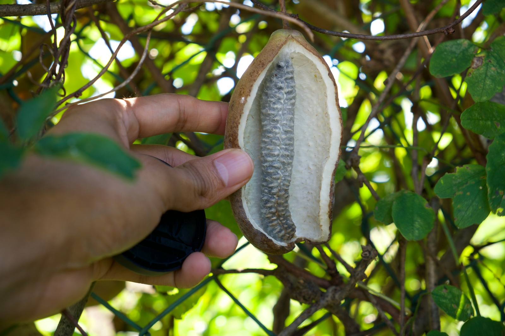
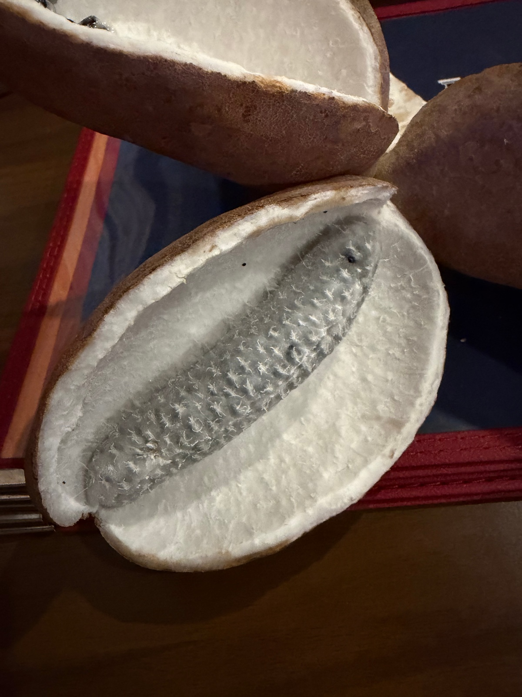
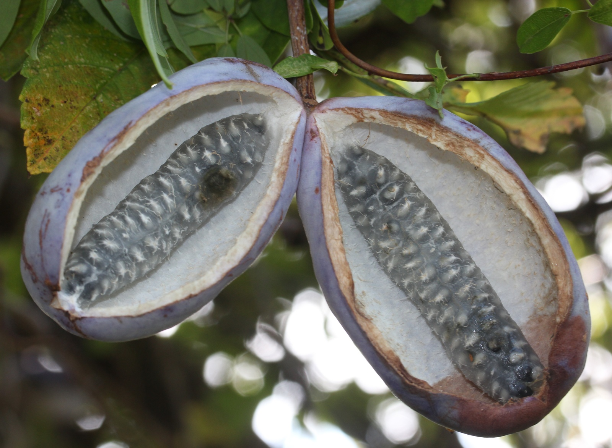
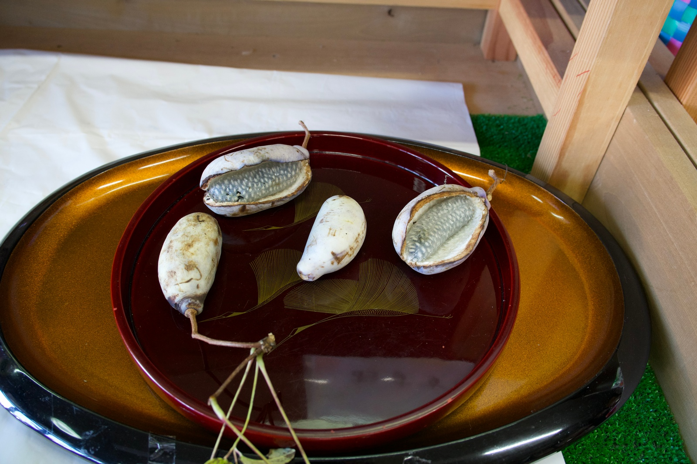
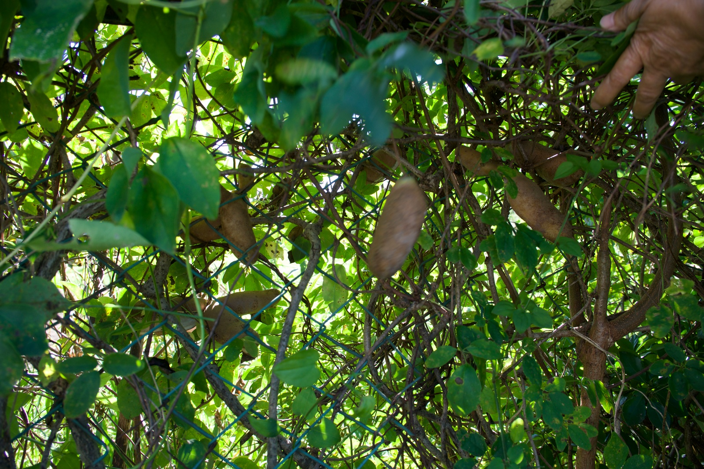
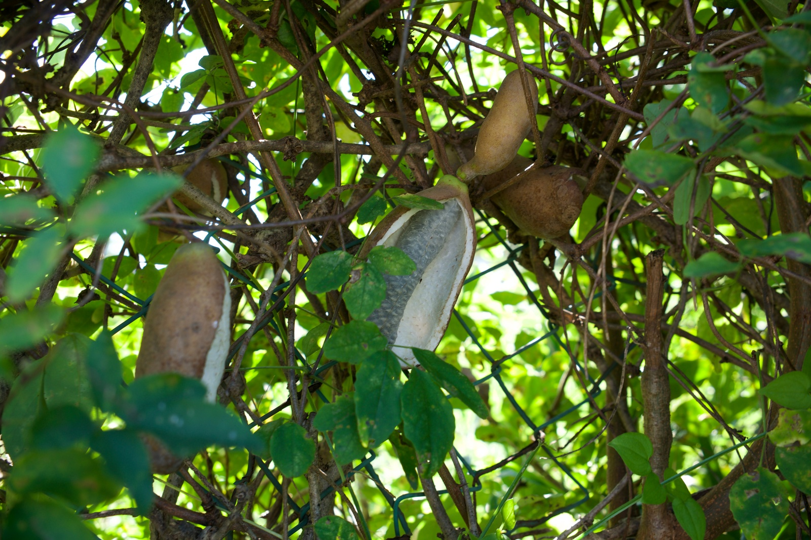

import T from "../../components/i18n/T.astro";
import Explain from "../../components/content/Explain.astro";
import Quiz from "../../components/content/Quiz.astro";

<Quiz
  id="akebi-know"
  question={{
    en: "Do you know what this is?",
    ja: "これが何か知っていますか？",
    en_simple: "Do you know what this is?",
  }}
  options={[
    { en: "Yes", ja: "はい" },
    { en: "No", ja: "いいえ" },
  ]}
/>

<T>
  
    Have you ever seen this fruit? I hadn't either before coming to Japan.
    Actually, when I first saw it, I thought it might be a cocooned caterpillar!
    It's actually a fruit called akebi, and it's known in Japan for being from
    the Tohoku region.
  
  
    この果物を見たことがありますか？私も日本に来るまで見たことがありませんでした。実は、初めて見たとき、繭に包まれたイモムシかと思いました！これは「あけび」という果物で、日本では東北地方のものとして知られています。
  
  
    Do you know this fruit? It's akebi! It's from Tohoku in Japan.
  
</T>

<T>
  
    Akebi grows wild on vines in the mountains of Japan, China, and Korea. Its
    English name is "chocolate vine," because its spring flowers are dark purple
    and smell a little like chocolate. As for the taste...
  
  
    あけびは日本、中国、韓国の山でつるに自生しています。英語の名前は「チョコレート・バイン（チョコレートのつる）」です。春に咲く花が濃い紫色で、少しチョコレートのような香りがするからです。では、味はというと……
  
  
    Akebi grows on <Explain meaning="long plants that climb up trees and walls">vines</Explain> in the mountains. In English,
    it's called "chocolate vine"! It's sweet and soft.
  
</T>

<figure>
  
  <figcaption>
    <T>
      An akebi, split open on the vine
      つるの上で割れたあけび
      Akebi!
    </T>
  </figcaption>
</figure>

## <T>First Taste初めての味My First Akebi</T>

<T>
  
    Actually, I had heard about it and seen it many times since coming to Takko,
    but it wasn't until last month that I got the chance to eat it. I was at a
    restaurant in town called <a href="https://takkotaco.com/restaurants/yodaka/">Yodaka</a> one night, and an older man had brought some
    to talk about and share with the other customers. He told us it's somewhat
    rare, but you can find it growing around Takko.
  
  
    実は、田子に来てから何度も話を聞いたり見たりしていましたが、食べる機会があったのは先月が初めてでした。ある夜、町の<a href="https://takkotaco.com/restaurants/yodaka/">よだか</a>というお店にいたら、年配の男性があけびを持ってきて、その話をしながら他のお客さんにも分けてくれました。少し珍しいけれど、田子の周りで生えているのを見つけられるそうです。
  
  
    I ate akebi last month. I was at <a href="https://takkotaco.com/restaurants/yodaka/">Yodaka</a>. Yodaka is a restaurant in Takko. A
    man brought some for everyone. It grows around Takko!
  
</T>

<figure>
  
  <figcaption>
    <T>
      Akebi at Yodaka
      よだかで出会ったあけび
      At Yodaka
    </T>
  </figcaption>
</figure>

<T>
  
    When I cut the middle part with a spoon, it looked jelly-like. I expected it
    to taste like a date based on the appearance, but I was pleasantly surprised
    to find it didn't (I don't like dates). It was more like the texture of a
    banana, though you can feel the seeds as well, and a pleasant sweet taste
    that was a bit hard to describe. Maybe like a lychee? Honestly, I can't
    remember too well, but I know I liked it because I ended up eating the rest
    by myself.
  
  
    真ん中の部分をスプーンで切ると、ゼリーのようでした。見た目からデーツ（なつめやしの実）のような味だと思っていましたが、そうではなくてうれしい驚きでした（私はデーツが苦手です）。食感はどちらかというとバナナに近く、種も感じられました。そして、言葉で表すのが少し難しい、心地よい甘さがありました。ライチに近いかな？正直あまりよく覚えていませんが、結局残りを一人で全部食べてしまったので、気に入ったのは確かです。
  
  
    It tasted good! It was like lychee. Also, it was like banana.
  
</T>

<figure>
  
  <figcaption>
    <T>
      They come in purple too, apparently! (Photo: <a href="https://commons.wikimedia.org/wiki/File:Akebia_quinata_fruits_0s2.JPG">Alpsdake, Wikimedia Commons</a>, CC BY-SA 3.0)
      紫色のものもあるそうです！（写真：<a href="https://commons.wikimedia.org/wiki/File:Akebia_quinata_fruits_0s2.JPG">Alpsdake, Wikimedia Commons</a>, CC BY-SA 3.0）
      Purple akebi! (Photo: <a href="https://commons.wikimedia.org/wiki/File:Akebia_quinata_fruits_0s2.JPG">Alpsdake, Wikimedia Commons</a>, CC BY-SA 3.0)
    </T>
  </figcaption>
</figure>

<T>
  
    While the fruit was delicious, the skin was quite bitter. I usually like
    eating vegetables with the skin on, like kabocha, sweet potatoes, and
    carrots, but this was just too bitter. I wondered, is it even safe to eat
    raw? (It's not dangerous, I looked it up! But it <Explain meaning="really tasted that way">sure tasted like it was</Explain>.)
    That night, I asked the chef to try cooking it for me, thinking it might
    take away some of the bitterness. We tried it with and without oil and salt,
    but it didn't change the flavor at all! Apparently, the skins are sometimes
    stuffed with vegetables or meat and then baked or roasted.
  
  
    実はおいしかったのですが、皮はかなり苦かったです。私はふだん、かぼちゃやさつまいも、にんじんなど、野菜を皮ごと食べるのが好きですが、これはさすがに苦すぎました。そもそも生で食べても大丈夫なのかな、と思いました。（調べてみたら、危なくはないそうです！でも、本当にそう思えるような味でした。）その夜、苦みが少しでも取れるかもしれないと思って、シェフに焼いてみてもらいました。油と塩をつけたり、つけなかったりして試しましたが、味はまったく変わりませんでした！皮に野菜や肉を詰めて、焼いて食べることもあるそうです。
  
  
    The fruit was yummy. But the skin was very bitter! The chef cooked the skin
    for me, but it was still bitter.
  
</T>

<figure>
  
  <figcaption>
    <T>
      Akebi at the farmers market
      産直で売られていたあけび
      At the market
    </T>
  </figcaption>
</figure>

<T>
  
    I saw a few being showcased at the farmers market recently as well. They
    seemed to be a bit <Explain meaning="no longer fresh">past their prime</Explain>, however, so I <Explain meaning="decided not to buy them">passed on them</Explain>.
  
  
    最近、産直でもいくつか並んでいるのを見かけました。でも、少し食べごろを過ぎているようだったので、買うのはやめておきました。
  
  
    You can buy it at the farmers market sometimes. It's a <Explain meaning="hard to find">rare</Explain> item.
  
</T>

## <T>Akebi in the wild野生のあけびI found akebi!</T>

<T>
  
    Soon after my first tasting of akebi, I <Explain meaning="found by chance">ran into</Explain> akebi again while at the
    ceramics club. It was growing on vines right behind the clubhouse! The
    grandmas showed me after I asked them about it. Sadly, they were not good for
    eating, though I didn't quite understand why, but it was still amazing to
    see them on their vines. I never would have guessed these to be edible fruit
    by their outward appearance!
  
  
    初めてあけびを食べてすぐ後、陶芸クラブでまたあけびに出会いました。クラブの建物のすぐ裏で、つるになっていたのです！おばあちゃんたちに聞いたら、教えてくれました。残念ながら、食べるのには向いていないそうで、理由はよくわかりませんでしたが、それでもつるになっているのを見られたのはすごかったです。見た目からは、これが食べられる果物だとは絶対に思わなかったでしょう！
  
  
    I found akebi again at my <Explain meaning="making cups and bowls from clay (in Japanese: 陶芸, tougei)">ceramics</Explain> club. It was behind the building! The grandmas said,
    "You can't eat these." But it was so cool to see.
  
</T>

<figure>
  
  <figcaption>
    <T>
      They look like potatoes, don't they?
      じゃがいもみたいに見えませんか？
      They look like potatoes, don't they?
    </T>
  </figcaption>
</figure>

<T>
  
    In early autumn, the purple pods split open by themselves to show the white
    fruit inside (like in the photo below). In Takko dialect, akebi is "agubi,"
    and people used to weave baskets from its vines. Both are in my
    <a href="https://takkotaco.com/takko-ben/dictionary/">Takko-ben dictionary</a>.
  
  
    秋の初めになると、紫色の実は自然に割れて、中の白い果肉が見えるようになります（下の写真のように）。田子弁では、あけびを「あぐび」と言い、昔はそのつるでかごを編んでいたそうです。どちらも私の<a href="https://takkotaco.com/takko-ben/dictionary/">田子弁辞書</a>に載っています。
  
  
    In autumn, akebi opens by itself. In Takko, people call it "agubi." People
    made baskets from the vines. You can find both words in my
    <a href="https://takkotaco.com/takko-ben/dictionary/">Takko-ben dictionary</a>.
  
</T>

<figure>
  
  <figcaption>
    <T>
      Some had already opened by themselves
      自然に割れていたものもありました
      Open akebi
    </T>
  </figcaption>
</figure>

<T>
  
    I'm always learning so many new things living in the Japanese countryside.
    I'm grateful that old man decided to share with us that night, I'm not sure
    I would have tried it otherwise. I don't think I've seen it at a normal
    grocery store, so I wonder if I'll get to try it again anytime soon, but
    maybe I'll run into some good ones in the wild one day.
  
  
    日本の田舎に住んでいると、いつも新しいことをたくさん学んでいます。あの夜、あのおじいさんが分けてくれて本当によかったです。そうでなければ、食べてみることはなかったかもしれません。普通のスーパーでは見たことがないと思うので、またすぐに食べられるかはわかりませんが、いつか山でおいしいあけびに出会えるかもしれません。
  
  
    Akebi is good. I think you should try it if you can! Please come to Japan
    and look for some.
  
</T>
